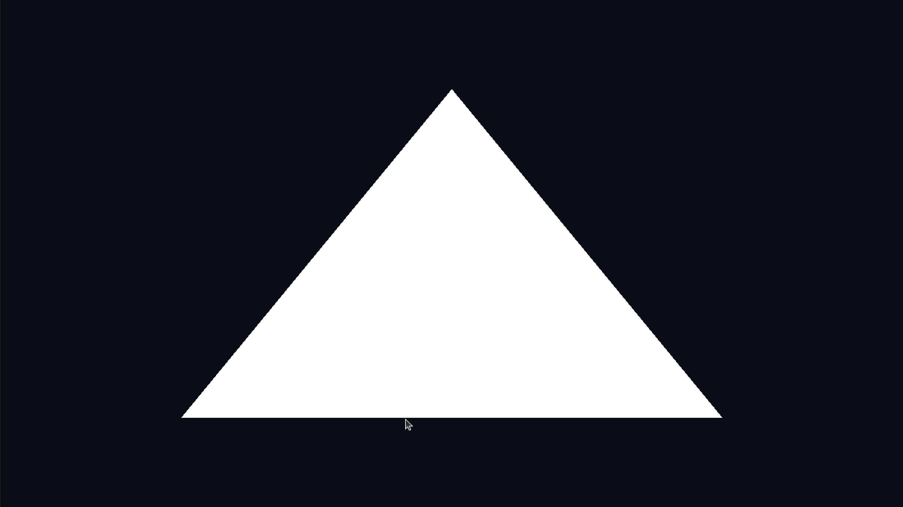
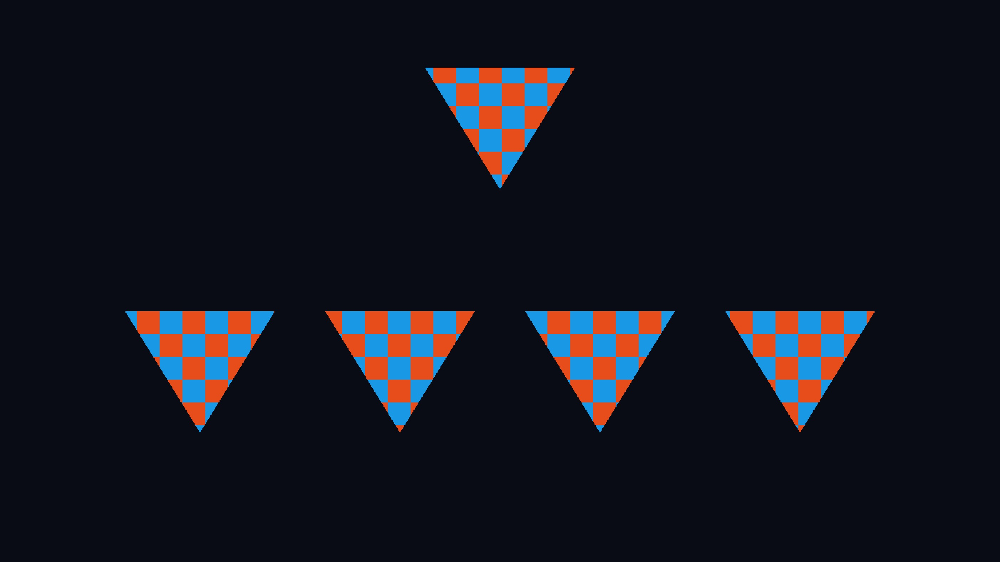

# Task 1: Drawing your first triangle

## VAO and indexed drawing

The `create_vao` function creates and binds a VAO, uploads the 3D vertex coordinates to a VBO, and describes each vertex as three `GL_FLOAT` values. It then enables vertex attribute 0 and uploads the indices to an element buffer, which remains tied to the VAO. In the render loop, the shader is activated, and `gl::DrawElements` is called with `gl::TRIANGLES`.

The final scene contains five triangles, with indices ranging from `0` to `15`. Each group of three indices defines one triangle, as already stated in the assignment.

{width=90%}

\newpage

# Task 2: Geometry and theory

## a) Clipping

**i) What is the name of this phenomenon?**

The phenomenon is called clipping.

**ii) When does it occur?**

Clipping happens when a primitive (like a triangle) extends outside the camera’s view volume. In this case, the first vertex has `z = -1.2` , and the third has `z = 1.2`.
Since the valid clip-space depth range is `-1` to `1`, the triangle intersects both the near and far clipping planes.

OpenGL removes the parts outside the view volume, so the resulting shape no longer resembles the original triangle.

**iii) What is its purpose?**

Clipping removes invisible parts of primitives before rasterization (while preserving the geometry of the visible portions inside the view volume).

{width=90%}

## b) Face culling and winding

**i) What happens?**

After swapping two indices, the triangle becomes invisible. The index order shifts from `0, 1, 2` to `0, 2, 1`, reversing the vertex traversal direction.

**ii) Why does it happen?**

The swap reverses the winding order of the triangle from counterclockwise to clockwise and, since face culling is enabled in `main.rs`, OpenGL considers the triangle as a back face and discards it.

**iii) What is the condition under which this effect occurs? Determine a rule.**

By default OpenGL considers a triangle frontfacing if its projected vertices have a counterclockwise winding. Swapping two indices flips the sign of the projected signed area, causing the triangle to switch between frontfacing and backfacing.

If it becomes backfacing, it gets discarded.

{width=90%}

{width=90%}

\newpage

## c) Theory

**i) Why does the depth buffer need to be reset each frame?**

The depth buffer must be cleared every frame because it stores the closest depth values from previous frames. If a primitive moves to the right without clearing it, old depth values may incorrectly occlude fragments that should be visible. This leads to holes or parts disappearing.

**ii) In which situation can the Fragment Shader be executed multiple times for the same pixel?**

Without multisampling, the fragment shader can run multiple times for a single pixel when overlapping primitives cover that pixel. Each primitive generates its own fragment, and depth, stencil, and blending tests determine the final pixel output.

**iii) What are the two most commonly used types of Shaders?**

The two most common shaders are:

- Vertex Shader: processes input vertices, transforms their positions, and passes data to the next stage in the pipeline.
- Fragment Shader: processes rasterized fragments and determines their output values (like color).

**iv) Why is it common to use an index buffer?**

An index buffer separates vertex data from connectivity, allowing the same vertex to be reused in multiple triangle. This reduces memory usage and avoids duplicating vertex data.

**v) When would you pass a non-zero value to gl::VertexAttribPointer?**

The final argument is normally null when an attribute begins at the start of the bound VBO. A non-zero pointer is used when the attribute starts at an
offset, for example with interleaved data where each vertex stores position followed by colour.

The colour attribute pointer would point past the position values within each vertex record.

## d) Shader modifications

**i) Mirror/flip the whole scene both horizontally and vertically.**

In the vert shader, I simply negated both `position.x` and
`position.y` before assigning `gl_Position`.

{width=90%}

**ii) Change the colour of the drawn triangles.**

The fragment shader changes the output colour from white to blue.

{width=90%}

\newpage

# Task 3: Bonus

## a) Checkerboard

I chose and implemented the checkerboard pattern in the fragment shader using `gl_FragCoord`.

The fragment coordinates are divided into 32 pixel cells, and the parity of the sum of the cell coordinates selects one of two colors.

{width=90%}

# Note on development environment

This assignment was developed on macOS (ARM architecture) using UTM with an Ubuntu VM.

The project required the following environment variables to run correctly in the VM:

```bash
MESA_LOADER_DRIVER_OVERRIDE=llvmpipe LIBGL_ALWAYS_SOFTWARE=true WINIT_UNIX_BACKEND=x11 cargo run
```

I'm available to create a detailed PDF documentation of this procedure for future students.
