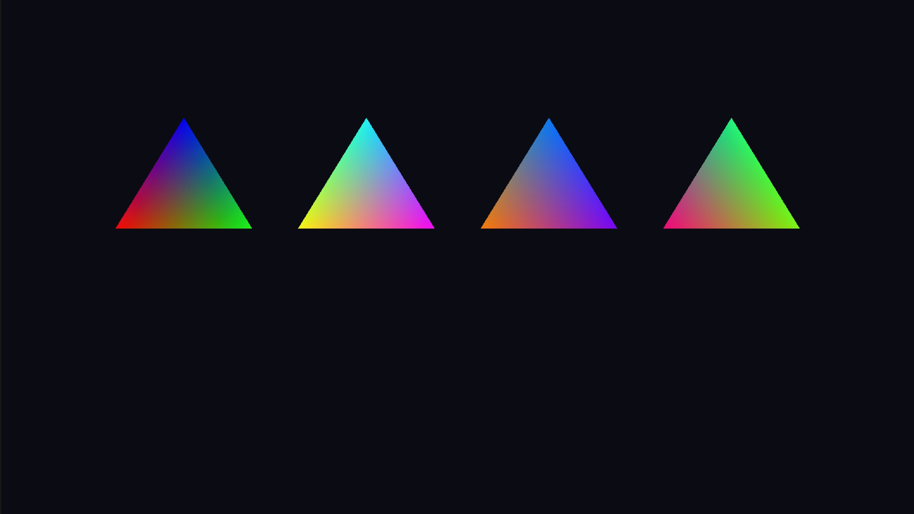
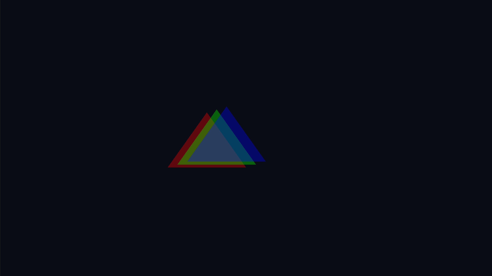
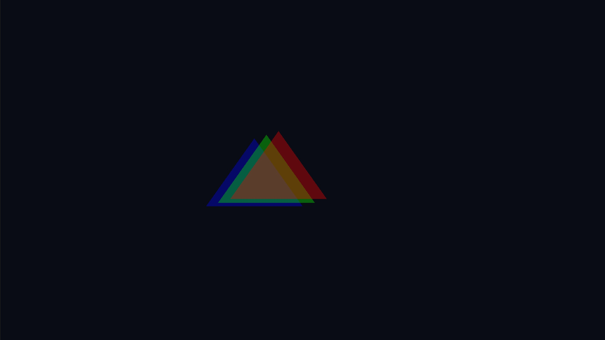
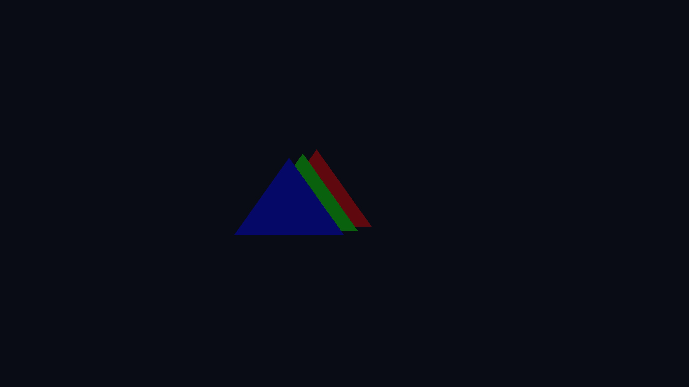

# Task 1: Per-Vertex Colors

## Task 1a

I added a separate color buffer to the VAO and connected it to vertex attribute location `1`. The buffer contains one RGBA color for each vertex.

## Task 1b

I used four triangles in the scene. Each vertex has its own color, so the three corners of each triangle have different colors.

{width=80%}

The color is not constant inside a triangle. OpenGL interpolates the color values between the three vertices when generating the fragments, which gives the smooth color transitions.

\newpage

# Task 2: Alpha Blending and Depth

## Task 2a

I used three triangles which overlap in part of the screen. The vertices of each triangle have the same `z` value, while the triangles have different depths.

| Triangle | Color | Alpha | `z` coordinate | Drawing order |
|---|---|---:|---:|---:|
| 1 | Red | 0.35 | 0.60 | First |
| 2 | Green | 0.35 | 0.30 | Second |
| 3 | Blue | 0.35 | 0.00 | Third |

The triangles are drawn from back to front. With the coordinate system used in the assignment, positive `z` is farther from the screen, so the triangle at `z = 0.60` is drawn first.

All three vertices of each triangle have the same color, so the color stays uniform.

{width=80%}

Alpha blending is enabled with:

```rust
gl::Enable(gl::BLEND);
gl::BlendFunc(gl::SRC_ALPHA, gl::ONE_MINUS_SRC_ALPHA);
```

## Task 2b

### Swapping triangle colors

I swapped the red and blue colors in the color buffer, without changing the positions or the drawing order.

\newpage

{width=80%}

The color in the overlapping area changed after the swap. The triangles are blended one after another, so changing the color of a triangle changes the input to the next blending step. This gives a different final color in the overlapping area.

### Swapping triangle depths

I then swapped the `z` coordinates of the first and third triangles while keeping their colors and index order unchanged.

{width=80%}

The result in the overlapping area changed again. After swapping the depths, the triangles were no longer in the same back-to-front order. The depth buffer also affects which fragments pass the depth test, so changing the `z` values changes which fragments contribute to the final image.

\newpage

# Task 3: The Affine Transformation Matrix

## Task 3b

The effects I observed were:

| Value | Observed effect | Transformation type | Axis |
|---|---|---|---|
| `a` | Changes the width of the scene | Scaling | `x` |
| `b` | Shears the scene horizontally | Shearing | `x`, dependent on `y` |
| `c` | Moves the scene horizontally | Translation | `x` |
| `d` | Shears the scene vertically | Shearing | `y`, dependent on `x` |
| `e` | Changes the height of the scene | Scaling | `y` |
| `f` | Moves the scene vertically | Translation | `y` |

Only the selected value was changed in each experiment, while the other values were kept as in the identity matrix. For example, when testing `a`, `e` was kept at `1.0`.

## Task 3c

Since I changed only one element at a time, none of these changes produced a rotation. A rotation needs several matrix elements to change together.

# Task 4: Combinations of Transformations

## Task 4c

The camera controls are:

| Key | Motion |
|---|---|
| `W` / `S` | Forward / backward along the `z` axis |
| `A` / `D` | Left / right along the `x` axis |
| `Space` / `Shift` | Up / down along the `y` axis |
| Left / Right arrow | Horizontal rotation |
| Up / Down arrow | Vertical rotation |

For the camera, I apply the inverse translations and rotations to the scene. The transformation matrix is rebuilt every frame starting from the identity matrix, and the resulting matrix is sent to the vertex shader through the `transformation` uniform.

# Note on development environment
As the previous assignment, this project was developed on macOS (ARM architecture) using UTM with an Ubuntu VM.