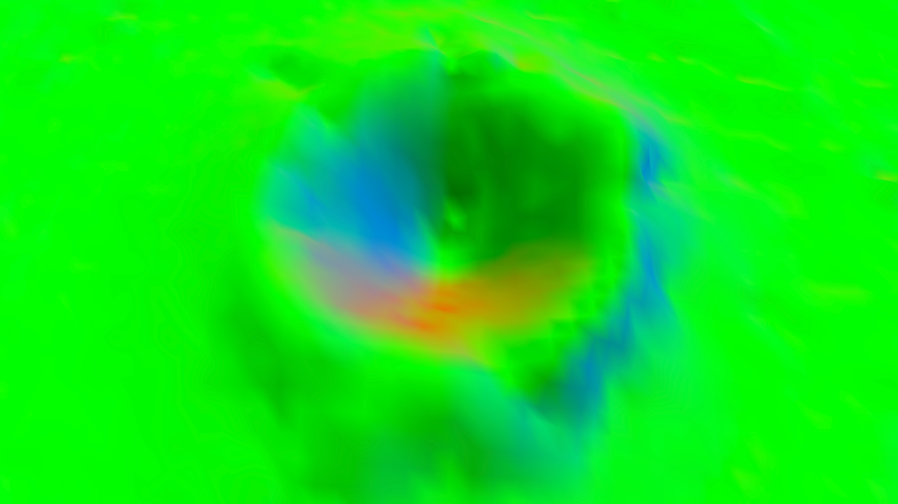
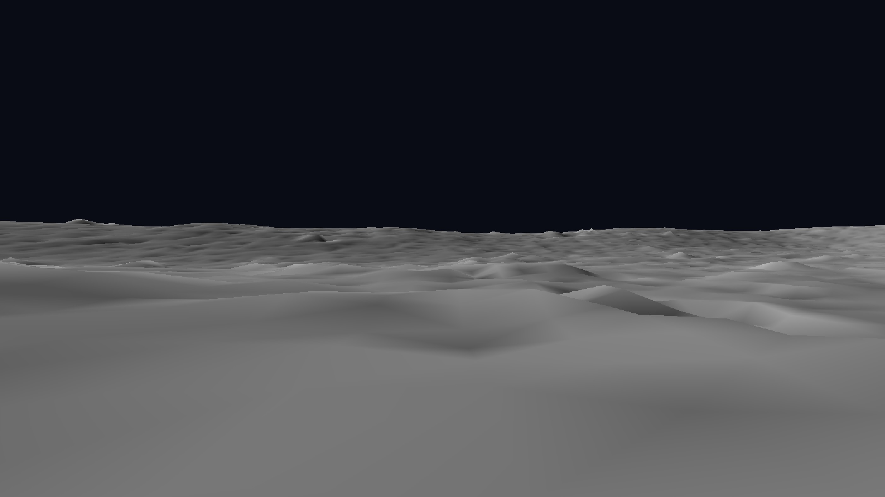
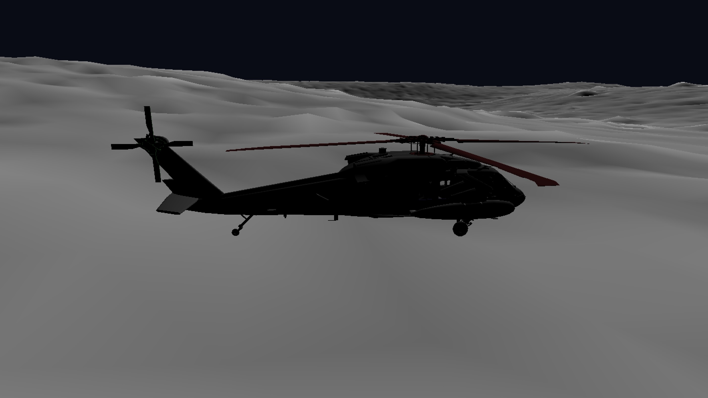
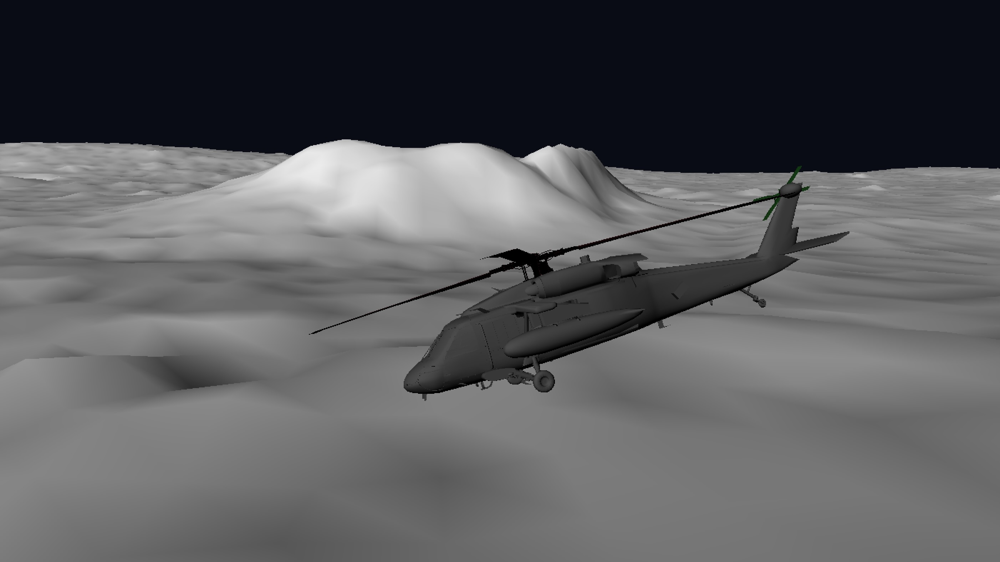
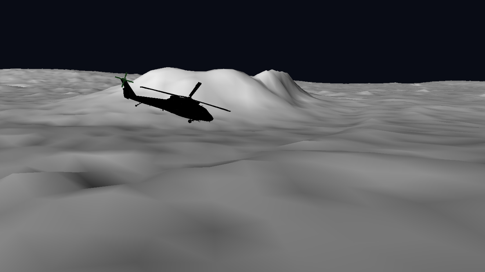
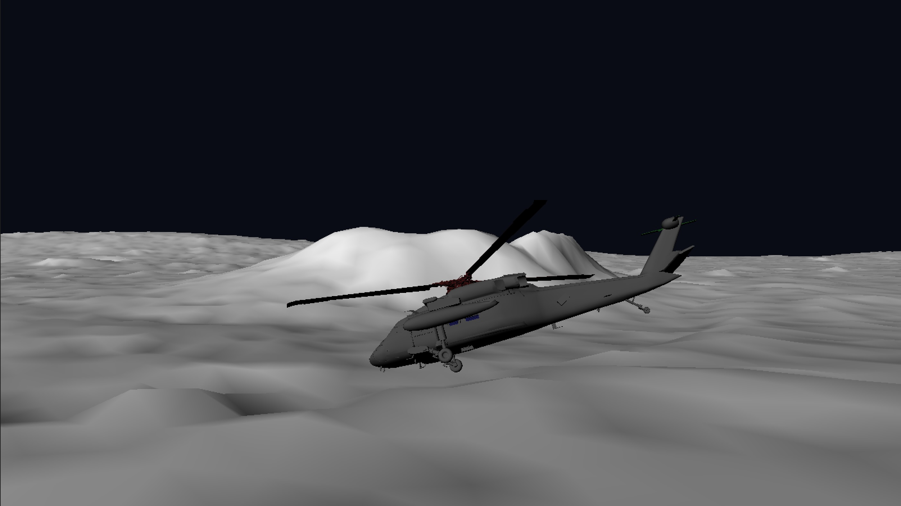
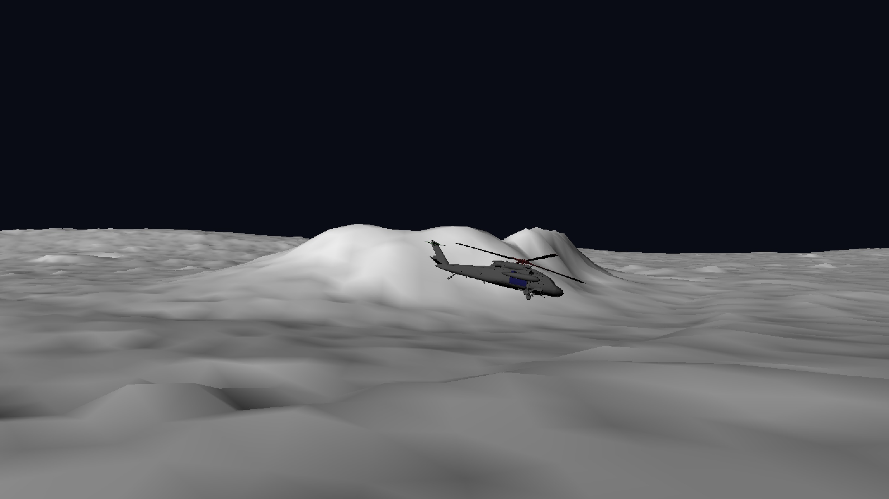
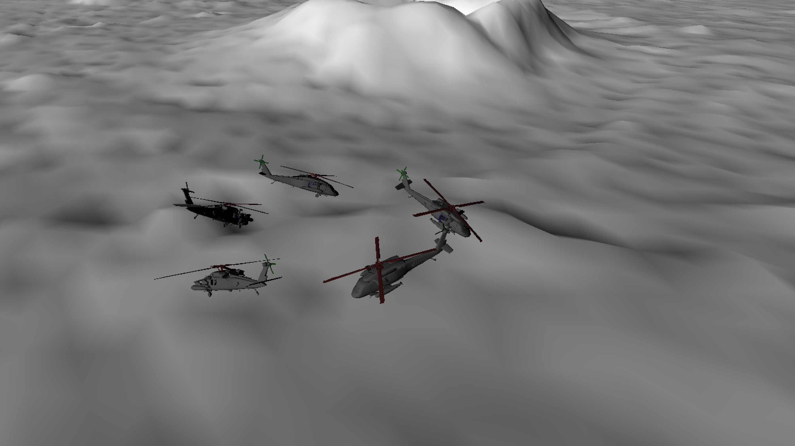
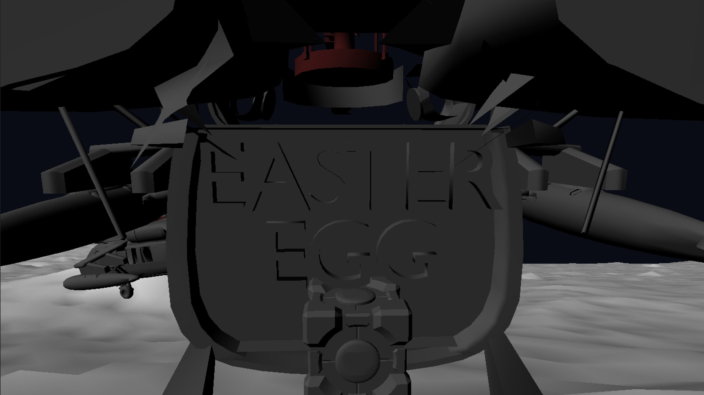

# Task 1: More polygons than you can shake a stick at

## Task 1c

The vertex shader receives the normal vectors and passes them to the fragment shader. During this step, I visualized the normal components directly as RGB values.

{width=90%}

I've increased the speed of the camera to make it easier to fly around the terrain compared to the previous assignment.

\newpage

## Task 1d

I implemented Lambertian lighting in the fragment shader. The light direction is:

```glsl
vec3 lightDirection = normalize(vec3(0.8, -0.5, 0.6));
```

The final RGB color is calculated as:

$$
\mathit{color}_{RGB} \cdot \max(0, \mathit{normal} \cdot (-\mathit{lightDirection}))
$$

The alpha component is preserved so that lighting does not make the terrain transparent.

{width=90%}

\newpage

# Task 2: Helicopter Parenting

## Task 2c

The scene is rendered by recursively traversing the scene graph in depth-first order. Each drawable node binds its VAO and draws its own index buffer.

{width=90%}

\newpage

# Task 5: Help! My lighting is wrong!

## Task 5a

Before transforming the normals, the illumination pattern remained fixed relative to the helicopter while it moved and rotated. This happened because the normal vectors were defined in model space and were not rotated together with the model, as already stated in the assignment description.

{width=90%}

{width=90%}

The two images above are taken from the same camera position.

\newpage

## Task 5c

The vertex shader extracts the upper-left 3x3 part of the Model matrix and applies it to each normal before normalizing it:

```glsl
normal = normalize(mat3(model) * vertex_normal);
```

This excludes model translation and preserves the normal's unit length after transformation.

{width=90%}

{width=90%}

The two images above are taken from the same camera position.

\newpage

# Task 6: Time to turn this thing up to 5

## Task 6a

I instantiated five helicopter roots that share the same four VAOs. Each helicopter has its own scene graph nodes for the body, door, main rotor, and tail rotor. The animation time is offset for each root, so all helicopters follow the same path without colliding.

{width=90%}

\newpage

# Task 7: Optional Challenges

## Task 7d: Animated Door

The helicopter door is animated with the `E` key. While the key is held, the door gradually slides by `-2.0` along the Z axis, otherwise it returns to its original position.

## Task 7f: Easter Egg

I found the hidden easter egg inside the helicopter model.

{width=90%}

